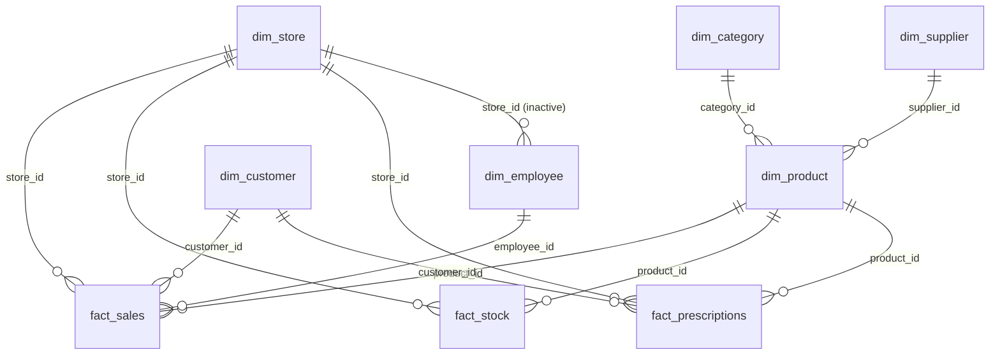

# Meridian Health Dashboard

An interactive **Power BI** dashboard for a pharmacy / health-retail chain. It brings sales, profit, products, customers, inventory risk, and a profit **what-if simulator** into one six-page report, built on a star-schema model with 30+ DAX measures.

> **Tools:** Power BI Desktop · DAX · Power Query (M) · Databricks SQL Warehouse
> **Canvas:** 1920 × 1080, dark theme (`#0B1220`) on the Fluent 2 base theme

---

## Table of Contents

1. [Business Questions](#business-questions)
2. [Report Pages](#report-pages)
3. [Data Model](#data-model)
4. [Key DAX Measures](#key-dax-measures)
5. [What-If Simulator](#what-if-simulator)
6. [Data Source](#data-source)
7. [How to Open](#how-to-open)
8. [Notes and Possible Improvements](#notes-and-possible-improvements)

---

## Business Questions

- How are sales, profit, and margin performing overall, by store, and by region?
- Which products and categories drive profit, and which ones have weak margins?
- Who are the customers, how loyal are they, and how often do they come back?
- Which stock items are below reorder level or close to expiry, and how much value is at risk?
- What happens to profit if prices, volume, costs, or discounts change?

---

## Report Pages

| # | Page | What it shows |
|---|------|---------------|
| 1 | **Overview** | Headline KPIs (Total Sales, Total Profit, Profit Margin %, Avg Basket, Transactions), sales vs. profit trend, top products by profit, store comparison, sales by payment method, and inventory alerts (Below Reorder Items, Expiry Risk Items). |
| 2 | **Stores** | Store-level deep dive: sales, profit, margin, employees, and transactions, plus profit by employee, sales by city, category breakdown, a Sales vs. Last Year KPI, and store manager details. Reached by **drillthrough** on `store_name`, with a Back button. |
| 3 | **Products** | Sales, profit, margin, and units sold. Includes a scatter chart (sales vs. margin vs. units by category), margin by category, top products by profit, and a product/brand table. Filters: region, category, brand. |
| 4 | **Customers** | Active Customers, Avg Basket, Avg Revenue per Customer, and Repeat Rate. Includes loyalty-tier mix, revenue by tier, sales by city, and a customer table. Filters: region, city, loyalty tier. |
| 5 | **Inventory** | Stock Units, Stock Value, Stock Value at Risk, Below Reorder Items, and Expiry Risk Items. Includes expiry risk by category, below-reorder items by store, a stock trend, and a product/store stock table. Filters: region, category, supplier. |
| 6 | **What If** | Four parameter slicers (Price, Volume, Cost, Extra Discount) that drive simulated sales, cost, profit, and margin versus the current baseline. |

Every page has a shared side **page navigator** and a **region** dropdown slicer.

---

## Data Model

Star schema with three fact tables and six dimensions. All relationships are many-to-one with single-direction filtering.



| Table | Type | Approx. rows | Description |
|-------|------|-------------:|-------------|
| `fact_sales` | Fact | ~9.9K | Sales lines: quantity, unit price, discount %, payment method, total, cost, profit, margin |
| `fact_stock` | Fact | ~10K | Stock by store/product/batch: quantity, reorder level, expiry date, `below_reorder_flag`, `expiry_risk_flag` |
| `fact_prescriptions` | Fact | ~10K | Prescriptions: doctor, issue date, dosage |
| `dim_product` | Dimension | ~5K | Product, brand, category, supplier, price, cost, pack size, strength, form, storage condition |
| `dim_customer` | Dimension | ~1.5K | Customer, city, signup date, loyalty tier |
| `dim_employee` | Dimension | ~120 | Employee, position, hire date, pharmacist flag |
| `dim_store` | Dimension | ~12 | Store, region, city, manager |
| `dim_supplier` | Dimension | ~5 | Supplier and contact details |
| `dim_category` | Dimension | ~9 | Product categories |
| `_Measures` | Measure table | n/a | Holds all report measures |
| `Price Change`, `Volume Change`, `Cost Change`, `Extra Discount` | Parameter tables | n/a | What-if inputs generated with `GENERATESERIES` |

> Row counts are approximate and were read from the model's column statistics.

The `dim_employee → dim_store` relationship is **inactive** on purpose. The `Employees` measure activates it with `USERELATIONSHIP`, so employee headcount by store works without creating an ambiguous filter path through `fact_sales`.

---

## Key DAX Measures

**Sales and profitability**

```dax
Total Sales     = SUM ( fact_sales[total_amount] )
Total Cost      = SUM ( fact_sales[cost_amount] )
Total Profit    = SUM ( fact_sales[profit] )
Profit Margin % = DIVIDE ( [Total Profit], [Total Sales] )
Avg Basket      = DIVIDE ( [Total Sales], [Transactions] )
Sales LY        = CALCULATE ( [Total Sales], SAMEPERIODLASTYEAR ( fact_sales[sale_date] ) )
Sales YoY %     = DIVIDE ( [Total Sales] - [Sales LY], [Sales LY] )
```

**Customers**

```dax
Active Customers         = DISTINCTCOUNT ( fact_sales[customer_id] )
Avg Revenue per Customer = DIVIDE ( [Total Sales], [Active Customers] )
Repeat Customers         = COUNTROWS (
                               FILTER ( VALUES ( dim_customer[customer_id] ),
                                        CALCULATE ( DISTINCTCOUNT ( fact_sales[sale_id] ) ) > 1 ) )
Repeat rate              = DIVIDE ( [Repeat Customers], [Active Customers] )
```

**Inventory risk**

```dax
Below Reorder Items = CALCULATE ( COUNTROWS ( fact_stock ), fact_stock[below_reorder_flag] = TRUE () )
Expiry Risk Items   = CALCULATE ( COUNTROWS ( fact_stock ), fact_stock[expiry_risk_flag] = TRUE () )
Stock Value         = SUMX ( fact_stock, fact_stock[quantity] * RELATED ( dim_product[cost_price] ) )
Stock Value at Risk = CALCULATE ( [Stock Value], fact_stock[expiry_risk_flag] = TRUE () )
Below Reorder %     = DIVIDE ( [Below Reorder Items], COUNTROWS ( fact_stock ) )
```

**People**

```dax
Pharmacists      = CALCULATE ( COUNTROWS ( dim_employee ), dim_employee[position] = "Pharmacist" )
Pharmacist Sales = CALCULATE ( [Total Sales], dim_employee[position] = "Pharmacist" )
```

---

## What-If Simulator

The **What If** page lets a user test scenarios with four sliders:

| Input | Range | Effect |
|-------|-------|--------|
| Price Change | -20% to +20% | Scales sales |
| Volume Change | -30% to +30% | Scales both sales and cost |
| Cost Change | -20% to +20% | Scales cost |
| Extra Discount | 0% to 20% | Adjusts sales through the discount factor |

```dax
Discount Factor  = DIVIDE ( 1 - ( [Average Discount %] + [Extra Discount Value] / 100 ),
                            1 - [Average Discount %] )

Simulated Sales  = [Total Sales]
                   * ( 1 + [Price Change Value] / 100 )
                   * ( 1 + [Volume Change Value] / 100 )
                   * [Discount Factor]

Simulated Cost   = [Total Cost]
                   * ( 1 + [Volume Change Value] / 100 )
                   * ( 1 + [Cost Change Value] / 100 )

Simulated Profit = [Simulated Sales] - [Simulated Cost]
Profit Change    = [Simulated Profit] - [Total Profit]
Simulated Margin % = DIVIDE ( [Simulated Profit], [Simulated Sales] )
```

Each slicer value is read with `SELECTEDVALUE(..., 0)`, so with nothing selected the simulation equals the current baseline.

---

## Data Source

- Data is loaded with **Power Query** from a **Databricks SQL Warehouse**.
- Catalog: `workspace` · Schema: `meridianhealth`.
- Tables loaded: `dim_category`, `dim_customer`, `dim_employee`, `dim_product`, `dim_store`, `dim_supplier`, `fact_prescriptions`, `fact_sales`, `fact_stock`.

---

## How to Open

1. Install **Power BI Desktop** (the file uses a recent PBIR report format, so use an up-to-date version).
2. Open `Meridian_Health_Dashboard.pbix`.
3. When prompted, sign in to Databricks to refresh the data. Without access, the report will open but will not be able to refresh.
4. Start from the **Overview** page and use the left navigator to move between pages. To reach the **Stores** page, right-click a store in a visual and choose **Drill through → Stores**.

---

## Notes and Possible Improvements

- `fact_prescriptions` and the `Prescriptions` and `Sales YoY %` measures are in the model but are not yet used in any visual. A Prescriptions page would be a natural next step.
- `Transactions` returns formatted text (`FORMAT`), and `Avg Basket` divides by it. Returning a number and applying the format in the visual would be safer.
- The report uses auto date/time tables. A single shared Date table would make time intelligence (such as `Sales LY`) more consistent across facts.
- Dropdown slicers with no fields on some pages (for example the second slicer on Overview) are placeholders and can be wired up or removed.
